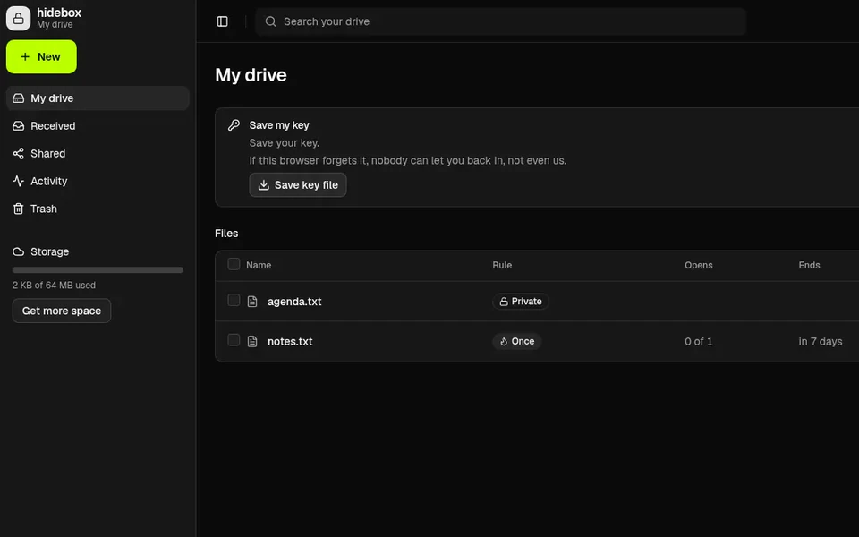
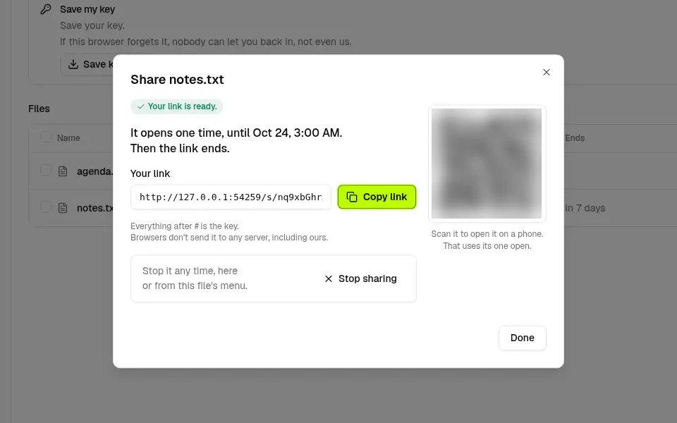
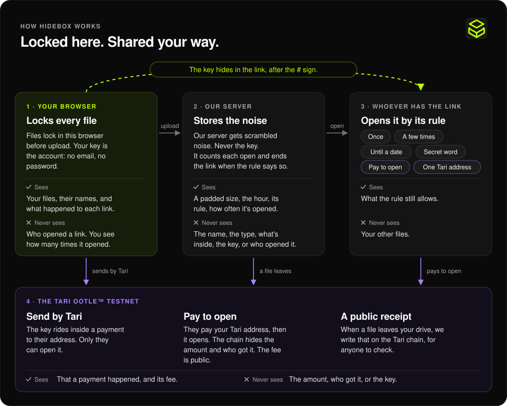

<!-- SPDX-License-Identifier: MIT -->
<div align="center">


# hidebox

**Your private cloud storage. Privacy isn't an option. It's the default.**

A private drive. Files lock in this browser before upload.<br>
You pick how each one opens: once, with a word, or for Tari™.

[**Open the live drive**](https://srv2052606.hstgr.cloud) · [For judges](https://srv2052606.hstgr.cloud/judges) ·
[How it works](https://srv2052606.hstgr.cloud/how) · [Under the hood](https://srv2052606.hstgr.cloud/made) · [Docs](docs/README.md)

[](https://srv2052606.hstgr.cloud/status.json)


[](LICENSE)

</div>

<a href="https://srv2052606.hstgr.cloud"></a>

## Try it in 2 minutes

One device, no wallet, no sign-up. The second track, with a phone and Tari, is on
[/judges](https://srv2052606.hstgr.cloud/judges).

1. On the [home page](https://srv2052606.hstgr.cloud), tap **Open your drive**. Your drive opens, with your Tari address. No email.
2. On a computer, drop a small folder on it. Each file says Locking, then Uploading.
3. On one file: **Share**, keep **Once**, turn on **Delete it from my drive after**, **Make link**.
4. Open the link in a private window and tap **Open it**. Reload: "This link has ended."
5. Back in your drive, open **Activity**: opened, then "It left your drive." That goes on the Tari chain within 15 minutes.
6. Tap **What our server knows**: a padded size, the hour, the rule, how many times it opened each hour, and its folder.

<p align="center">
  
  
</p>

## How it works



The key hides in the link, after the # sign. Browsers don't send it to any server, including ours.
Every party, fact by fact: [/made#who](https://srv2052606.hstgr.cloud/made#who) and
[docs/privacy.md](docs/privacy.md). Where Tari comes in, and how to check each part: [docs/tari.md](docs/tari.md).

## Exit rules

Each file or folder gets its own rule. You can stop a link any time, from its menu.

| Rule | What happens |
|---|---|
| **Once** (the default) | It opens one time. Then the link ends. |
| **A few times** | It opens up to 3 times. Then the link ends. |
| **Until a date** | Anyone with the link can open it until then: tomorrow, or in a week. |
| **Public link** | Anyone with the link can open it until you stop it. |
| **Secret word** | They need the link and the word. Send the word a different way than the link. |
| **One Tari address** | Send by Tari: the key rides inside a payment to their address. Only they can open it. |
| **Pay to open** | They pay your Tari address, then it opens. The chain shows a payment with a hidden amount and a hidden owner. The fee is public. |
| **Delete it after** | When the link ends, the file leaves your drive too. When a file leaves your drive, we write that on the Tari chain, for anyone to check. |

## What the server never sees

Our server gets scrambled noise. Never the key.

| Never sees | Sees, and keeps |
|---|---|
| Names, types, contents and real sizes of your files and folders | Ciphertext, and a padded size, so the real size stays hidden |
| File keys, link secrets, passwords or your seed | A hash of the login key, and a hash of each link's access token |
| Who opened a link, or who holds one | How many times a link opened in each hour |
| Your IP address on disk: it sees it while you're connected and never writes it to a log | The hour a file arrived, its rule, and which files share a folder (never a name) |

We count opens per hour. We never store who opened it or their IP address.
Pay links: we keep half of the key and give it to each buyer once the chain shows their payment. The other half is in the link. Neither half opens it alone.

## Run it yourself

```sh
git clone https://github.com/c7b/hidebox && cd hidebox
python3 -I tools/build.py --config deploy/config/mutis.toml.example --origin http://127.0.0.1:8787 \
  --web web --out /tmp/mutis-dist --release /tmp/mutis-release
python3 -I server/bin/mutis-api --dev --data /tmp/mutis-dev --dist /tmp/mutis-dist --port 8787 --pow-bits 10
```

Open <http://127.0.0.1:8787>: `--dev` runs the real API with a fake wallet, indexer and chain, so every flow
completes offline. A real deployment: [docs/self-host.md](docs/self-host.md). Check the live site against a
commit, and run the tests: [docs/verify.md](docs/verify.md).

## Architecture

- **Browser:** the app is ES modules with no build step. WebCrypto does AES-256-GCM with a fresh key per file, HKDF and PBKDF2; the vendored official `ootle-wasm` 0.46.0 seals keys and builds Tari sends.
- **API:** `mutis-api`, Python 3.13 standard library only, behind Caddy. SQLite holds ids, hashes and counters; ciphertext sits on disk. It runs as its own user and can't reach the wallet.
- **Chain worker:** `mutis-chain` runs relay sends, the UTXO mirror, payment proofs (official library in a Node 20 sidecar) and SealLog checkpoints, through the official `tari_ootle_walletd`.
- **SealLog:** an Ootle template (Rust, compiled to WASM): a public Merkle log of stored-file hashes, exit receipts and release notarizations, checked in your browser at `/verify`.
- **Release:** a per-route CSP, SRI on each page's top-level scripts and stylesheets, and a hash manifest of every served file, notarized on chain; `tools/verify-deploy.py` compares the live site with a commit.

Nothing is installed from npm or pip; one pinned, hash-checked third-party piece (`ootle-wasm`, see [NOTICE](NOTICE)).
More: [docs/architecture.md](docs/architecture.md) · [docs/threat-model.md](docs/threat-model.md) · [docs/api.md](docs/api.md).

## Status and roadmap

| When | What |
|---|---|
| **Now** | Live on the Esmeralda testnet. tTARI is the coin on Tari's test network. It is worth nothing. |
| **October 2026** | Built for the Tari Ootle contest "Spooky Secrets"; the judged release is the tag `spooky-secrets-2026-10`. |
| **Nov 11, 2026** | The Ootle mainnet launches. hidebox stays on the testnet until its code is reviewed. |
| **After review** | Paid features open only after that review. |

Reviews of the live site and what each one changed: [docs/review/fix-log.md](docs/review/fix-log.md).
Evidence for every pass: [docs/evidence](docs/evidence). Security reports: [SECURITY.md](SECURITY.md).

## License

MIT, see [LICENSE](LICENSE); third-party work is listed in [NOTICE](NOTICE). Built with AI coding agents
under the author's direction ([how it's built](docs/verify.md#how-its-built)).

Built on Tari Ootle™. **hidebox** is an independent project, not affiliated with, endorsed by, or sponsored
by Tari Labs, the Tari Council, or the Tari project. "Tari" is a trademark of Tari Labs.
